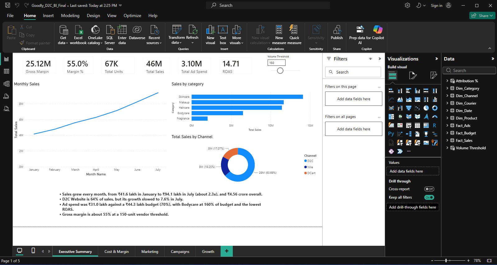
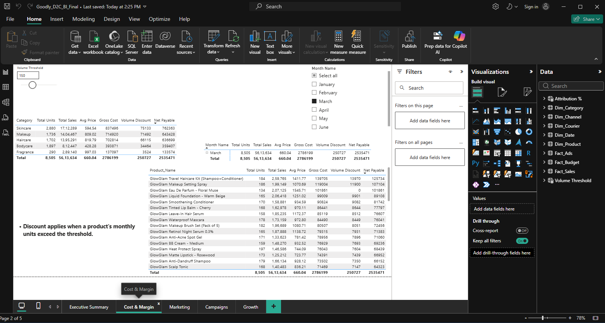
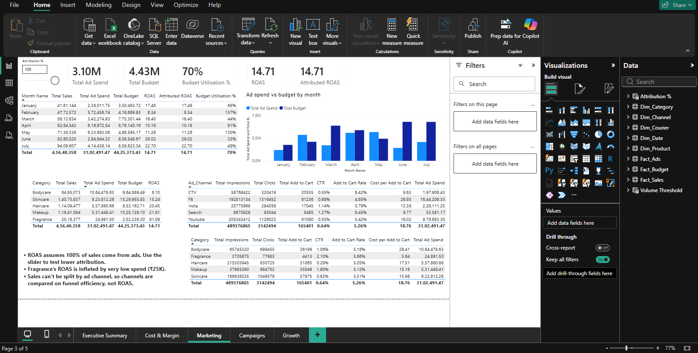
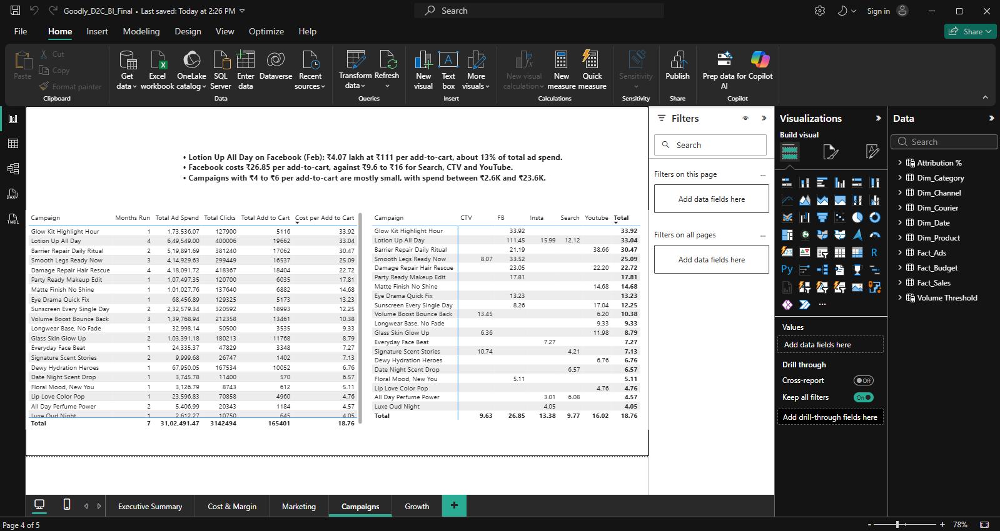
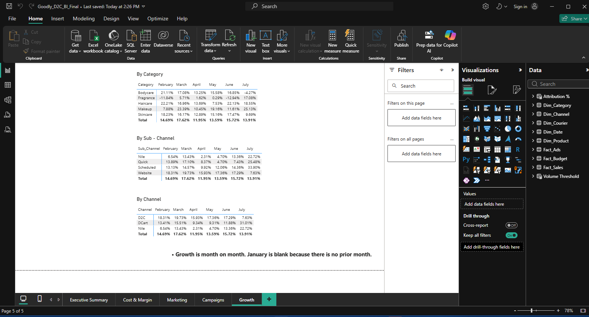

# D2C Brand Sales, Margin & Marketing Analytics: Power BI Dashboard

## 📊 Project Overview
This project builds a Power BI model and 5-page report for a fictional D2C beauty and personal-care brand. It combines 49,239 sales rows from three channels with vendor cost agreements and ad data, and tracks sales, margin and marketing performance in one executive view.

> **Note:** This is a self-directed practice project based on an assessment brief I found in a LinkedIn job posting. It is not affiliated with, submitted to, or endorsed by the company that posted it, and it is not paid work. All data in the brief is mock data. The raw data files and the `.pbix` file are not included in this repository.



## 🎯 Business Problem
In the case's management discussion, leadership asked for:
- **Sales:** one view of three channels (D2C Website, DCart, Nile) that refreshes when new files arrive.
- **Cost and margin:** vendor cost taken from the agreement that applied on each sale date, plus a 10% volume discount when a product's monthly units exceed a threshold (150, adjustable). Net payable = total cost minus total volume discount.
- **Marketing:** ad spend vs budget, return on ad spend (ROAS) with an adjustable sales-attribution %, and a funnel view.
- **Deliverable:** an executive dashboard, not table dumps.

## 🗂️ Data Sources
| Source | Used for |
|---|---|
| `sales_D2C_2025-01..07.csv` | D2C Website sales |
| `DCart_Sales_2025-01..07.xlsx` | DCart sales (Scheduled and Quick Commerce sheets) |
| `Nile_Sales_YTD.xlsx` | Nile sales (7 monthly sheets) |
| `Product and Cost Details.xlsx` | Product list and vendor cost by agreement |
| `Ad_Campaign_Data.csv` | Campaign impressions, clicks, add-to-carts, CPC |
| `Performance Marketing Ad Spends Budget.xlsx` | Monthly budget by category |

## 🧱 Data Model (Star Schema)
- **Facts:** `Fact_Sales` (49,239 rows), `Fact_Ads` (35), `Fact_Budget` (35)
- **Dimensions:** `Dim_Date`, `Dim_Product`, `Dim_Category`, `Dim_Channel`, `Dim_Courier`
- **Parameters:** `Volume Threshold` (default 150), `Attribution %` (default 100)
- **Relationships (9, all many-to-one, single direction):**
  1. `Fact_Sales[SKU_Code]` → `Dim_Product[SKU_Code]`
  2. `Fact_Sales[Courier]` → `Dim_Courier[Courier]`
  3. `Fact_Sales[Sales_Date]` → `Dim_Date[Date]`
  4. `Fact_Sales[Channel_Key]` → `Dim_Channel[Channel_Key]`
  5. `Fact_Sales[Category]` → `Dim_Category[Category]`
  6. `Fact_Ads[Category]` → `Dim_Category[Category]`
  7. `Fact_Budget[Category]` → `Dim_Category[Category]`
  8. `Fact_Ads[Month_Start]` → `Dim_Date[Date]`
  9. `Fact_Budget[Month_Start]` → `Dim_Date[Date]`

`Dim_Category` is shared by all three fact tables, so facts never link to each other directly.

## 🔄 Data Preparation (Power Query)
- Combined many files with the **Folder connector**, so new monthly files are picked up on refresh. Kept `Source.Name` as an audit trail.
- Dropped D2C's pre-built Month/Year/Week/Delivery days and **rebuilt them once** for all channels from the date columns.
- Kept `Rider_Distance_Km` blank for non-Quick-Commerce rows. This is "not applicable", not an error.
- **Matched each sale to its vendor agreement by date** with a nested-table lookup, and checked that no sale was left without a cost (0 rows).
- Built a composite `Channel_Key` (Channel | Sub_Channel | Delivery_Type), because `Sub_Channel` alone is not unique.
- Parsed the packed `Ad_Descriptor` field and calculated ad spend as CPC × Clicks.
- Reshaped the budget matrix by unpivoting months into rows.
- Turned off Enable Load for staging queries.

Code: [`power-query/`](power-query/)

## 🧮 DAX Measures
29 measures: cost and margin, sales, marketing, funnel and growth. Highlights:

```DAX
Volume Discount =
SUMX(
    SUMMARIZE(Fact_Sales, Dim_Date[Month], Fact_Sales[SKU_Code]),
    VAR Units = [Total Units]
    VAR Cost = [Gross Cost]
    RETURN IF(Units > [Volume Threshold Value], Cost * 0.1, 0)
)
Net Payable = [Gross Cost] - [Volume Discount]
Attributed ROAS = DIVIDE([Attributed Sales], [Total Ad Spend])
MoM Growth % = DIVIDE([Total Sales] - [Sales Prev Month], [Sales Prev Month])
```
The discount is worked out for each month and SKU separately. The 10% rate is fixed, as in the brief. Only the threshold is adjustable.

All measures: [`dax/measures.dax`](dax/measures.dax)

## 📑 Report Pages
| Page | Contents |
|---|---|
| Executive Summary | Gross margin, margin %, total sales, units, ad spend and ROAS cards; monthly sales; sales by category and channel; threshold slicer |
| Cost & Margin | Units, sales, gross cost and net payable by month, category and product; threshold and month slicers |
| Marketing | Spend vs budget, budget utilisation, ROAS and attributed ROAS, funnel tables; attribution slider |
| Campaigns | Cost per add-to-cart by campaign and ad channel |
| Growth | Month-on-month growth by category, sub-channel and channel |

### Screenshots
**Cost & Margin**



**Marketing**



**Campaigns**



**Growth**



## 📈 Key Insights
- Sales grew every month, from **₹41.6 lakh in January to ₹94.1 lakh in July**. Total sales were ₹4.56 crore on 67,073 units.
- Month-on-month growth ran between about 12% and 18%.
- Channel mix: D2C Website 63.7%, Nile 19.3%, DCart 17.1%. D2C growth slowed to 7.6% in July, while DCart grew 31.0% and Nile 22.7%.
- Gross margin was about **₹2.51 crore (55.0%)** at the 150-unit threshold, and 53.7% at 200.
- Volume discount ₹18.1 lakh, giving net payable of ₹2.05 crore. Every sale matched a vendor agreement.
- Ad spend was ₹31.0 lakh against a ₹44.3 lakh budget (70% used). ROAS was 14.71 at 100% attribution and 4.41 at 30%.
- **Bodycare** used 160% of its budget and had the lowest ROAS (6.1). Fragrance's ROAS (81) rests on only about ₹25K of spend.
- **Facebook** cost ₹26.85 per add-to-cart, against ₹9.6 to ₹16.0 for Search, CTV and YouTube. One campaign, Lotion Up All Day on Facebook in February, spent ₹4.07 lakh at ₹111 per add-to-cart (about 13% of all spend).

## 🧩 Challenges I Solved
- Fixed a backwards Date relationship (a "duplicate value" error) by correcting the cardinality.
- Replaced a non-unique `Sub_Channel` key with a composite `Channel_Key`, checked with `List.Difference`.
- Removed a stray column that created a dimension-to-dimension link.
- Stopped new Fact_Sales columns leaking into dimensions by using "keep only these columns".
- Turned off Enable Load for staging queries to stop spurious auto-relationships.
- Cleaned messy Cost Structure headers and fixed a reversed unpivot.

## ⚠️ Limitations & Next Steps
- The 10% discount rate is fixed; making it adjustable would be a small extension.
- The brief mentioned four vendor agreements, but the data had three; I used all three.
- Sales can't be split by ad channel, so channels are compared on funnel efficiency, not ROAS.
- Next steps: parameterise the file paths, mark `Dim_Date` as a date table, and add drill-through from the executive page.

## 🧰 Skills Demonstrated
Power BI Desktop · Power Query (M) · DAX · star-schema data modeling · what-if parameters · budget vs actual and ROAS analysis · data validation checks

## 📁 Repository Contents
- `screenshots/`: screenshots of all five report pages
- `dax/measures.dax`: all 29 DAX measures
- `power-query/`: M code for the 8 loaded queries
- `README.md`: this file
